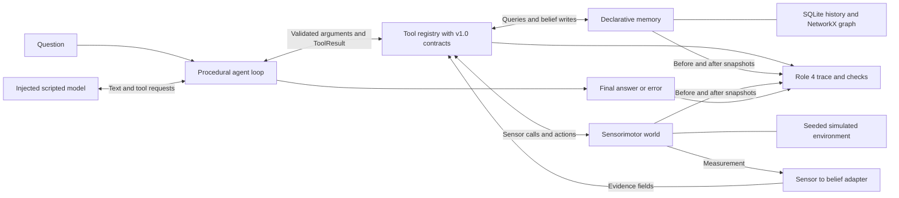

# I Agent Architecture Verification Report

I, Agent separates what the agent remembers, what it measures, and how it reasons. This report assembles the implementation and test evidence for the four roles. The Role 4 evaluation checks whether a run follows the evidence rules and records where a check fails. The run uses simulated worlds and a scripted model so the agent loop and tool boundaries can be exercised offline.

## Architecture and information flow

The procedural loop receives a question and gives the model registered tools. A tool request is validated, dispatched to its owner through the registry, and returned as a v1.0 `ToolResult`. The model receives the result in its conversation. The agent queries each layer through tools. Role 4 composes the layers and observes the calls, returns, and state transitions outside the reasoning loop.

[Editable diagram source](architecture.mmd)

| Shared contract | What the test can verify |
| --- | --- |
| `Belief` | Stored object value, data source, confidence, perspective, timestamp, validity interval, and link to any superseded belief |
| `SensorReading` | Sensor name, value and unit, observation status, timestamp and confidence |
| `ToolResult` | Schema version, tool name, timestamp and either validated data or a typed error |
| Evaluation log | Question, initial and final state, calls and results, answer or error, expected behavior, checks and outcome |

### Declarative memory

Based on [Vyom's report outline](../../role1/report_outline.md), [integration notes](../../role1/integration_notes.md), and the implementation in `declarative/`. `BeliefMemory` retains provenance and history in SQLite and exposes the belief graph with NetworkX. Queries can distinguish user, sensor, historical and third-party perspectives. Evidence priority is evaluated in `declarative/conflicts.py`; sufficient newer sensor evidence can supersede an older map while retaining that map in history. Low-confidence contradictions can be disputed. A missing source caps confidence at 0.5. An author-approved final prose section from Vyom is pending.

### Sensorimotor world

Based on [Asvin's layer documentation](../../sensorimotor_stack.md) and [world schema](../../sensorimotor_world_schema.md). The world simulates obstacles, objects, lighting, pose and time. Seeds and factory resets give independent, reproducible trials. LiDAR measures distance; the camera reports apparent color; action receipts report the resulting pose. The sensor-to-belief adapter converts observations into evidence fields without writing to memory. An author-approved final prose section from Asvin is pending.

### Procedural loop

Based on [Prem's setup and policy notes](../../procedural_setup.md) and the published implementation in `procedural/`. Prompt assembly supplies a system role, numbered evidence rules, an answer format and an optional entity-ID glossary. The loop checks evidence attempts before allowing an epistemic answer and can redirect an early answer. It bounds model calls, validates tool arguments and results, and checks the provenance and confidence of selected memory updates against evidence from the run. The verified safeguards and their gaps appear in tool traces and before/after state. An author-approved final prose section from Prem is pending.

Canonical main was verified at `3d1c934e12247b8d46151331232c9e11ed679e98`. Prem's newer `f8224493960450fad9324fc3f93460b79acebbd7` was evaluated separately. Its offline comparison ran 419 passing tests and 179 passing subtests, with two warnings. Its earlier integration controls still reproduced 17 passes and both known failures. The final rehearsal starts from canonical main.

### Scenario A memory transition

The Scenario A receipt in `evidence/trial_01/canonical/S01/run.json` shows `path_A/status` changing after a 12 cm blocked LiDAR reading. In the graph, the live `b_000002` record points back to historical `b_000001` through `supersedes`.

| State | ID | Value and source | Confidence | Status and link |
| --- | --- | --- | ---: | --- |
| Before | `b_000001` | Clear, `stored_map` | 0.85 | Active with no end to validity |
| After | `b_000001` | Clear, `stored_map` | 0.85 | Superseded, `valid_to` is `2026-10-03T09:16:00Z` |
| After | `b_000002` | Blocked, `lidar_front` | 0.98 | Active, supersedes `b_000001` |

The scripted S01 run writes the sensor update directly. Memory supersedes the earlier record and preserves its numeric confidence. The prompt suggests an explicit downgrade followed by the update, and the separate downgrade control exercises that tool call.

## Evaluation method and results

Role 4 uses independent worlds and stores per trial. The reference runs exercise deterministic scripted behavior and answer checks. The canonical and mixed runs exercise published layer implementations with a scripted model. Missing inputs use named fixture data or are recorded as unsupported capabilities. Backend and fixture labels travel with each result. Scenario B uses a demo seed with a blue `bot_02` claim and a box configured to look brown under yellow light. Its receipt attributes red to `user` (0.90, active), blue to `bot_02` (0.80, active), and brown to `camera_front` (0.90, disputed). The unimplemented temperature tool remains an unsupported capability, and unavailable LiDAR is tracked as a separate analogue.

| Case | Expected evidence behavior |
| --- | --- |
| S01 Map clear, LiDAR blocked | Check live evidence, cite the conflict and retain the previous map in history |
| S02 Map blocked, LiDAR clear | Report the newer clear reading with its timestamp and confidence |
| S03 Three perspectives | Keep the user's claim, camera reading and third-party record attributed separately |
| S04 Low confidence | Preserve the stronger map and report the uncertainty. A Scenario A variant sets the actual LiDAR to 0.25 confidence. |
| S05 Sensor disagreement | Retain both observations and request additional evidence. The second same-path LiDAR reading is a synthetic v1.0 fixture. |
| S06 Stale history | Distinguish stale and current evidence while retaining history. The route-status analogue uses an explicitly aged map and a fresh real reading. |
| S07 Missing evidence | Report what is missing and leave unsupported values unknown |
| S08 False user information | Keep user belief distinct from live evidence and avoid movement on blocked evidence |
| S09 Missing provenance | Preserve the null source and cap confidence at 0.5. The seeded battery value is a claim without a matching sensor tool. |
| S10 World change | Observe the changed world again before choosing an action. The harness inserts an obstacle through the simulator's exposed change hook. |

### Repeated trial results

Five fresh trials per case used the same seed, 42. Each control ran once.

| Scope | Runs | Passed behavior checks | Other outcomes |
| --- | ---: | ---: | --- |
| Reference | 50 | 50 (100%) | All ten cases passed on each repeat |
| Canonical and mixed | 50 | 45 (90%) | Five passes are scoped S07 unsupported-temperature probes. S09 failed in all five repeats. |
| Reference fault controls | 10 | 0 | All ten injected faults were detected |
| Canonical and mixed controls | 15 | 12 (80%) | The unsupported update, blocked-movement and stale-action controls exposed known behavior gaps |

All 125 verdicts matched the expected outcomes. Across the repeated cases, tool sequences, evaluated checks and before/after state were stable. All 14 boundary samples across 11 tools passed conformance. An independent evidence check read 437 JSON files, 190 JSONL files and all 45 metrics rows, and matched every standard run log to the summary.

Full offline discovery passed 405 tests and 179 subtests with two existing collection warnings and zero collection errors. The offline guard recorded zero blocked network attempts. A separate one-trial strict rehearsal returned status 2. The five-trial summary flags 13 evidence paths for that gate, including five scoped S07 probes, five S09 failures and three failing controls.

[Measured verification](verification.json) records the final commands, test counts, artifact checks and results. Packaged `evidence/summary.json` and `evidence/metrics.csv` contain the run-level and per-case evidence. Repeating a scripted fixture measures repeatability under those inputs. Hosted-model behavior and independent review of answer semantics remain unmeasured.

The [earlier integration controls](../teammate_integration/defects_and_decisions.md) still show two procedural failures. A tool request can use a genuine blocked sensor reading to store a contradictory clear belief. A movement request after blocked evidence is dispatched and moves 11 cm before simulated collision stopping. The final suite adds another movement control after a mid-run world change. The old clear observation is used for dispatch without a new read, and the robot moves 11 cm in the changed world. In the normal S09 probe, memory correctly caps the unsourced input at 0.5, but the missing battery tool and checklist prevent the scripted abstention. See the [failure analysis](failure_analysis.md) for owner routing and reproduction.

## Demonstration and delivery

The [demo runbook](demo_runbook.md) shows Scenario A and B, reproduces the suite, and builds a locally verifiable package. Its manifest records source and evidence file hashes. Fixture agreement, author input, cross-review and a team release decision remain pending. The [review packet](review_packet.md) records the local cross-check and names the outstanding decisions. The [mid-project slide and rehearsal materials](../phase_d/slide_content_and_notes.md) remain available as historical evidence.
